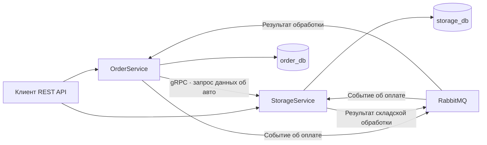

# Car Dealership Backend

Java-бэкенд мультибрендового автосалона. Клиент может оформить заказ на автомобиль из каталога, указать индивидуальную комплектацию или подать заявку на тест-драйв. Менеджер просматривает клиентские заказы и меняет их статусы. Склад ведёт каталог автомобилей и деталей, учитывает остатки и работает с внутренними заказами на сборку.

В доменной модели заданы допустимые переходы между статусами заказов и правила комплектации. Стоимость рассчитывается из базовой цены модели и доплат за выбранные детали. При расчёте проверяется наличие обязательных компонентов и их совместимость с моделью.

## Архитектура

| Сервис | За что отвечает | Хранилище |
| --- | --- | --- |
| `order-service` | Заказы автомобилей, заявки на тест-драйв, назначение менеджера и история состояний заказа | PostgreSQL, `order_db` |
| `storage-service` | Каталог автомобилей и деталей, складские остатки, заказы на сборку и gRPC API каталога | PostgreSQL, `storage_db` |



**События заказов.** При переводе заказа в статус «Оплачен» `OrderService` записывает новый статус и событие в одной транзакции PostgreSQL. Фоновая задача читает таблицу Outbox и отправляет события в RabbitMQ. `StorageService` получает событие, обрабатывает заказ на сборку и отправляет результат обратно. Для этого процесса используется паттерн Transactional Outbox.

**Запросы к каталогу.** Для REST-запросов `/api/v1/cars` и `/api/v1/cars/{id}` сервис заказов обращается к складу по gRPC. Контракт описан в `.proto`. Клиент ограничивает ожидание пятью секундами и возвращает HTTP `503`, если gRPC-вызов завершается ошибкой.

**Хранение и доступ.** У каждого сервиса собственные миграции Liquibase. Слой доступа к данным использует интерфейсы репозиториев и адаптеры Spring Data JPA. Фильтрация каталога реализована через JPA Specifications. Spring Security проверяет JWT от Keycloak и разграничивает доступ для клиентов, менеджеров, сотрудников склада и администраторов.

## Стек

| Область | Технологии |
| --- | --- |
| Приложение | Java 21, Spring Boot 3.2, Spring Web, Gradle |
| Данные | PostgreSQL 15, Spring Data JPA, Liquibase, MapStruct |
| Интеграции | REST, OpenAPI / Swagger UI, RabbitMQ, gRPC, Protocol Buffers |
| Авторизация | Spring Security, OAuth 2.0, JWT, Keycloak |
| Запуск и тесты | Docker Compose, JUnit 5, Testcontainers |

## Локальный запуск

Понадобятся JDK 21 и Docker с Compose. Выполняйте команды из корня репозитория.

**1. Создайте локальный файл `.env`.** Пример значений для разработки:

```dotenv
ORDER_DB_NAME=order_db
ORDER_DB_PORT=5433
STORAGE_DB_NAME=storage_db
STORAGE_DB_PORT=5434
POSTGRES_USER=postgres
POSTGRES_PASSWORD=local-postgres-password
RABBITMQ_DEFAULT_USER=dealership
RABBITMQ_DEFAULT_PASS=local-rabbit-password
KC_BOOTSTRAP_ADMIN_USERNAME=admin
KC_BOOTSTRAP_ADMIN_PASSWORD=local-keycloak-password
```

**2. Поднимите инфраструктуру.** Compose запускает два экземпляра PostgreSQL, RabbitMQ и Keycloak. При старте Keycloak импортирует realm `car-dealership`.
```bash
docker compose up -d
docker compose ps
```

**3. Запустите сервисы через Gradle.** В каждом из двух терминалов загрузите настройки подключения:

```bash
set -a
source ./.env
set +a

export SPRING_DATASOURCE_USERNAME="$POSTGRES_USER"
export SPRING_DATASOURCE_PASSWORD="$POSTGRES_PASSWORD"
export SPRING_RABBITMQ_USERNAME="$RABBITMQ_DEFAULT_USER"
export SPRING_RABBITMQ_PASSWORD="$RABBITMQ_DEFAULT_PASS"
```

В первом терминале запустите `./gradlew :order-service:bootRun`, во втором — `./gradlew :storage-service:bootRun`.

## Как попробовать API

| Интерфейс | Адрес |
| --- | --- |
| Swagger UI сервиса заказов | `http://localhost:8080/swagger-ui/index.html` |
| Swagger UI сервиса склада | `http://localhost:8082/swagger-ui/index.html` |
| Keycloak Admin Console | `http://localhost:8081` |
| RabbitMQ Management | `http://localhost:15672` |

Для запроса к API создайте тестового пользователя в realm `car-dealership`, назначьте ему роль `CUSTOMER` и получите JWT через клиент `car-service-client`. Передайте токен как `Authorization: Bearer <токен>`.

Начать можно с `GET /api/v1/cars` на порту `8080`. Этот запрос идёт в `OrderService`, который обращается к `StorageService` по gRPC на порту `9090`. В текущей версии список возвращает автомобили, отмеченные как доступные для тест-драйва.

## Интеграционные тесты

```bash
./gradlew integrationTest
```

Тесты используют Testcontainers для запуска PostgreSQL и RabbitMQ. В проекте есть проверки REST API, gRPC-клиента и gRPC-сервера, а также ответа при недоступности склада.
